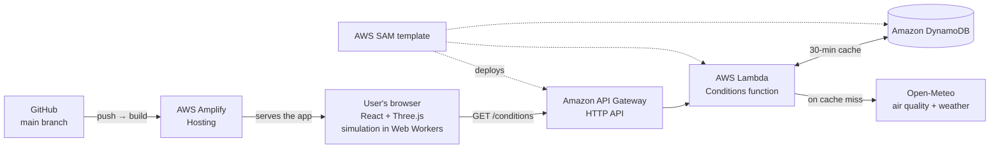

<div align="center">

<!-- Add a hero screenshot or GIF here once it exists, e.g.:

-->

# AirForce

### Visualise the way pollution spreads through your house

Design your home in 3D, see where the air goes stale and where pollution builds up, and find out which simple changes make the biggest difference.

[**Live demo**](https://main.d2iwbt8w1yhn6o.amplifyapp.com) · [**3-minute video**](https://www.youtube.com/watch?v=_shyE4hxEuE) · [**Build blog**](https://builder.aws.com/content/3KYWlGSOJfHdaJsP5HY6AECSj6T/airforce-visualise-the-way-pollution-spreads-through-your-house)


</div>

---

## Why AirForce?

In winter, Indian homes seal up. Windows close to keep the smog out and fans switch off, but the pollution already inside, from cooking, incense, mosquito coils or the smog that slipped in earlier, has nowhere to go. It builds up in the rooms and corners where air barely moves, and sometimes that corner is your bed.

**The pollution that affects you most isn't on the street outside, but in the room where you sleep.** AirForce makes that invisible air visible.

## What you can do

| Feature | Description |
|---|---|
| **Build your home** | Start from a single room or a whole house, then drag in doors, windows, furniture, fans, purifiers and pollution sources. No drawing skills needed. |
| **Describe its surroundings** | Floor level, how built-up the area is and your window type. The 3D scene updates as you answer. |
| **Simulate the air** | See PM2.5 levels, how stale the air is and how it flows, room by room and spot by spot. |
| **Use live conditions** | One click pulls the current outdoor PM2.5, wind and temperature for your location. |
| **Get ranked suggestions** | AirForce tries dozens of changes, like closing a window, moving the purifier or turning on the hood, and ranks them by how much they help. |
| **See why and compare** | Each suggestion shows the facts behind it, and you can preview it side by side before applying it. |
| **Save your builds** | Saved in your browser, or downloaded as a file to share. |

<!-- Add the three view screenshots here once they exist, e.g.:
<p align="center">
  
  
  
</p>
<p align="center"><em>Pollution · Ventilation (age of air) · Airflow</em></p>
-->

## How the simulation works

AirForce combines three models, each answering a different question.

| Model | What it answers | How |
|---|---|---|
| **Room box** | How much pollution builds up in a room over time? | Each room is one well-mixed space with gains (outdoor air, sources) and losses (ventilation, settling, purifiers). |
| **Room network** | How does air move between rooms? | Rooms are connected through windows, doors and gaps. Wind and temperature set pressures, and air flows from high to low pressure. Fast enough to update on every edit. |
| **3D grid** | Where exactly does air go stale? | The home is split into 20 cm cubes and air movement is simulated cell by cell, all inside your browser. |

The numbers behind it, such as wind behaviour, how easily air passes through openings, how fast fine dust settles and how much smoke cooking or incense releases, come from British ventilation standards (BS 5925, CIBSE), Indian fan standards and published research. Where no measurement exists, the value is marked as an estimate in the code (`src/simulation/constants.ts`).

> **Note:** AirForce gives simulated estimates from a simplified model. It is meant for comparing options, not for replacing a real air-quality monitor.

## Built on AWS

Every service is here because the app needs it.

<!-- To add official AWS icons: download the AWS Architecture Icons package from
https://aws.amazon.com/architecture/icons/, copy the SVGs into docs/assets/aws/,
then add a first column like:  -->

| Service | What it does in AirForce |
|---|---|
| **AWS Amplify Hosting** | Hosts the web app and rebuilds it from GitHub on every push to `main` |
| **Amazon API Gateway** | Public `/conditions` endpoint, restricted to our site (CORS) and rate-limited |
| **AWS Lambda** | Fetches live PM2.5, wind and temperature for the user's location |
| **Amazon DynamoDB** | Caches each location's conditions for 30 minutes |
| **AWS SAM** *(open source)* | Defines and deploys the whole backend from one template |
| **AWS IAM** | Least-privilege role for each function |

### Architecture



The simulation itself runs entirely in the browser. The backend only supplies real-world outdoor conditions.

## Run it locally

**Requirements:** Node.js 22 and npm.

```bash
git clone https://github.com/RJ1899157/aws-envhacks.git
cd aws-envhacks
npm install
npm run dev          # http://localhost:3000
```

To enable the **Live** conditions button, create `.env.local` with your API URL:

```bash
VITE_API_BASE_URL=https://<your-api-id>.execute-api.us-east-1.amazonaws.com
```

Without it, the app works fully with preset outdoor values.

| Command | What it does |
|---|---|
| `npm run dev` | Start the dev server |
| `npm test` | Run the unit tests |
| `npm run build` | Typecheck and build for production |
| `npm run sim:report` | Print a text report from the simulation models |

### Deploy the backend

```bash
cd infra
sam build
sam deploy --guided   # first time; afterwards just: sam deploy
```

See [`infra/README.md`](infra/README.md) for details.

## Project structure

```
src/
  ui/alt/         Guided interface (start, design steps, results)
  builder/        3D canvas, placement and simulation visuals
  simulation/     Room box, room network, 3D grid, scenarios and ranking
  services/       Calls to the AWS backend
infra/            AWS SAM template and Lambda function
```

## Limitations

- Results are estimates from a simplified model, not measurements.
- Warm air rising inside rooms, humidity and particle sizes are not modelled.
- Weather stays constant during a simulation run.
- Several reference values are literature-based estimates and are marked for verification in the code.

## Team

- [Sainava Modak](https://github.com/Sainava)
- [Piyush Singh](https://github.com/PixxySynchronous)
- [Rishab Jain](https://github.com/RJ1899157/aws-envhacks)
- [Gourav Garg](https://github.com/18gourav)

*(Satyam in the contributors refers to Piyush Singh)*


## Acknowledgements

- Air-quality and weather data from [Open-Meteo](https://open-meteo.com/) (CC BY 4.0).
- Built for the [WeMakeDevs × AWS Environmental Hacks](https://www.wemakedevs.org/aws/env) hackathon, Air track.